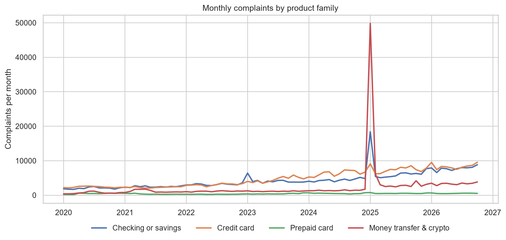
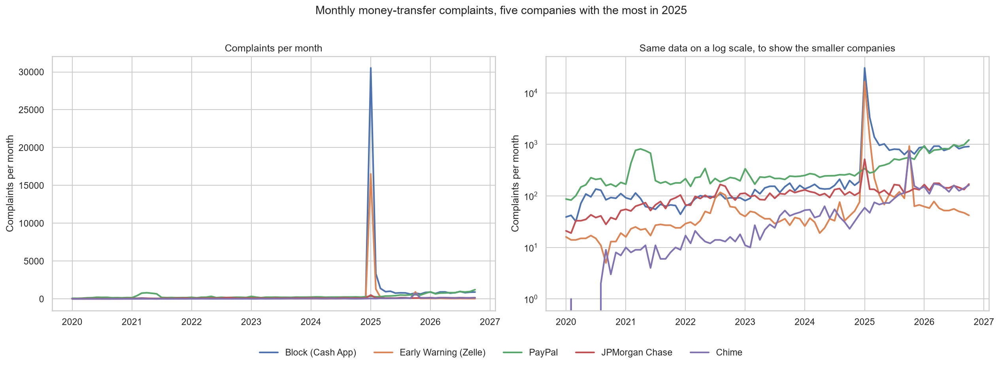
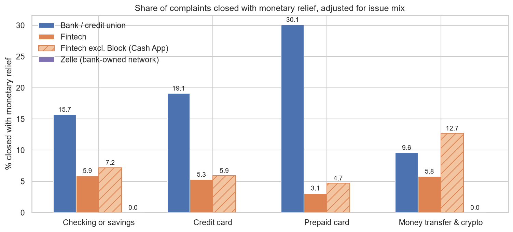

# Fintech vs Banks: What Are US Consumers Complaining About?

An analysis of **976,529 complaints** to the US Consumer Financial Protection Bureau (CFPB), January 2020 to mid-November 2026, using Python. It compares complaints against digital-first providers (fintechs) with complaints against traditional banks across four products where they compete directly: checking and savings accounts, credit cards, prepaid cards and money transfers (including crypto).

📓 **[Read the full analysis notebook](Fintech%20vs%20Banks%20Complaints%20-%20Exploratory%20Analysis.ipynb)**

## Purpose

A fintech's customer experience lead wants to know how complaints against fintechs compare with those against banks: which problems drive them, how that has changed, and how well companies resolve them. The analysis compares the two groups **within the same product** and, for outcomes, **adjusts for the type of problem**, so differences aren't just a result of fintechs and banks receiving different kinds of complaints.

## Key findings

- **Complaints about these four products quadrupled**, from 66,427 in 2020 to 265,328 in 2025, with 203,506 in 2026 up to mid-November. Fintechs' share was 12–17% from 2021 to 2024, jumped to 28% in 2025 because of a one-off spike, and is still 24% in 2026 without one.
- **Most of the 2025 money-transfer rise came in eight days.** Cash App and Zelle received 41,752 money-transfer complaints on 14–21 January 2025, equal to 62% of that year's rise. Most were labelled "Other transaction problem". Cash App's jump began on 16 January, the day the CFPB announced an order against its parent, Block. Zelle's began two days earlier, so that order can't explain it, and the data doesn't show what did.
- **Fintech and bank customers complain about different things, even for the same product.** In checking and savings, fintech customers complain nearly twice as often about unexpected charges and debits (19.2% vs 10.5%); bank customers complain more about low-balance problems such as overdrafts (8.6% vs 2.4%). In money transfers, fraud is a bigger share of bank complaints: 56% vs 42% for fintechs outside January 2025, and 51% vs 24% if a catch-all label that mixes fraud with other transaction problems isn't counted as fraud.
- **Fintechs close far fewer complaints with monetary relief than banks** for accounts (5.9% vs 15.7%), credit cards (5.3% vs 19.1%) and prepaid cards (3.1% vs 30.1%), after adjusting for the mix of issues. These gaps hold without Block (Cash App), without January 2025 and, for prepaid cards, without American Express. In money transfers, the gap comes from Cash App: it closed none of its 56,459 money-transfer complaints with monetary relief, and without it fintechs give relief more often than banks (12.7% vs 9.6%).
- **Outcomes vary widely within each group.** In money transfers, 27.9% of Coinbase's complaints and 13.6% of PayPal's close with monetary relief (raw rates), against 0% for Cash App and Zelle; in checking, Bank of America's rate is 35.4% and Capital One's 3.6%.







## Recommendations for a fintech customer experience lead

1. **Benchmark refund practice against banks, product by product.** For checking, credit cards and prepaid cards, banks are 2.7 to 10 times as likely to close a complaint with monetary relief, after adjusting for the type of issue. Review whether eligible disputes, such as unauthorised transactions, are being refunded.
2. **Focus on unexpected charges and transaction problems.** These are fintech customers' most distinctive complaints in checking (19.2% vs 10.5% for banks) and money transfers.
3. **Plan for sudden complaint surges.** Cash App's money-transfer complaints went from about 160 a month in 2024 to over 30,000 in January 2025, and Zelle's from about 40 a month to 16,528, mostly within a week. Regulatory news is one possible trigger, but Zelle's surge started before any matching announcement. Support capacity and a plan for clear customer communication should be ready before a surge, not built during one.
4. **Learn from fintechs that resolve complaints well.** Coinbase (27.9%) and PayPal (13.6%) close far more money-transfer complaints with monetary relief than Cash App (0%), on raw rates. So a low refund rate isn't simply a feature of being a fintech.
5. **Watch PayPal's rising volume.** Its money-transfer complaints reached 8,990 in 2026 by mid-November, already above 2025's 5,486, and October 2026 was its highest month so far.

## How the analysis keeps comparisons fair

- **Same product, not overall totals:** fintechs and banks sell different mixes of products, so issues, fraud and outcomes are always compared within a product family.
- **Issue-adjusted outcomes:** relief rates are directly standardised to a common issue mix within each product, so a group isn't penalised for receiving harder complaints.
- **Robustness checks:** every outcome comparison is repeated without Block (Cash App), the largest fintech, and issue mix, fraud and outcomes are repeated without January 2025, so neither one company nor the spike drives the results. Fraud shares are shown with and without a catch-all label that mixes fraud with other transaction problems, and banks' prepaid result is checked without American Express.
- **Open complaints left out:** the outcome analysis uses complaints received up to 17 September 2026, 60 days before the data ends, so recent complaints that may still be open don't lower the rates.
- **Consistent products over time:** in 2023 the CFPB split "Credit card or prepaid card" into two products; older complaints are assigned to credit or prepaid using their sub-product so trends don't break.
- **Dates:** the API's timestamps are UTC (checked in the notebook: US daytime filing shifts by daylight saving), so they're converted to US Eastern time before taking the date. Monthly trends stop at the last complete month.
- **Transparent grouping:** companies are grouped as bank, fintech, Zelle, money transmitter, credit bureau or other by ordered rules, and the full mapping for every company with 1,000+ complaints is printed in the notebook. Credit bureaus are left out of the comparisons because their complaints in these products are mostly about credit reports.

## Data

[CFPB Consumer Complaint Database](https://www.consumerfinance.gov/data-research/consumer-complaints/), public data published by a US federal agency. All complaints received from 1 January 2020 to 16 November 2026 for the products "Checking or savings account", "Credit card", "Prepaid card", "Credit card or prepaid card" (before 2023) and "Money transfer, virtual currency, or money service", downloaded from the CFPB's [complaint search API](https://cfpb.github.io/api/ccdb/).

The CFPB publishes complaints after the company responds or after 15 days, does not verify all facts in them, and notes that complaint data is not a statistical sample of consumers' experiences. See the CFPB's notes on the data for details.

**What's in this repository:**

- `data/sample/complaints_sample.csv`: a 20,000-row random sample of the full data (committed), so the notebook runs straight after cloning. Counts will be much smaller on the sample.
- `data/sample/profile.txt`: a profile of the full dataset (row counts by product and year, top companies, missing values).
- The full data (about 290 MB of CSVs, a 25 MB Parquet file) is not committed. The scripts below rebuild it.

## Repository structure

```
fintech-vs-banks-complaints-analysis/
├── Fintech vs Banks Complaints - Exploratory Analysis.ipynb   # the full analysis, 7 sections
├── figures/                     # charts saved by the notebook
├── scripts/
│   ├── download.py              # downloads complaints from the CFPB API, one product and year at a time
│   └── build.py                 # combines them into a Parquet file, saves the profile and the sample
├── data/
│   ├── sample/                  # 20,000-row sample and data profile (committed)
│   ├── raw/                     # downloaded CSVs (not committed)
│   └── processed/               # complaints_2020plus.parquet (not committed)
├── requirements.txt
├── .gitignore
├── LICENSE
└── README.md
```

## Notebook sections

1. Loading and preparing the data (including how companies are grouped)
2. How has complaint volume changed since 2020?
3. What drove the 2025 rise in money-transfer complaints?
4. Which companies receive the most complaints?
5. Do fintech and bank customers complain about different things?
6. How common are fraud and scam complaints, and for whom?
7. How do companies respond?

Followed by conclusions, recommendations and caveats.

## How to run

Requires Python 3.11+ and pandas 3.x (the analysis was run with Python 3.14 and pandas 3.1).

```bash
python -m venv .venv
.venv\Scripts\activate            # Windows  (macOS/Linux: source .venv/bin/activate)
pip install -r requirements.txt
```

To run on the sample, open the notebook and run all cells.

To run on the full data, first download and build it (the download takes a while and pauses between requests to be gentle on the API):

```bash
python scripts/download.py
python scripts/build.py
```

Then run the notebook. It uses `data/processed/complaints_2020plus.parquet` when it exists. Because the database keeps growing, a fresh download will give slightly different numbers from the ones above.

## Caveats

- Complaint counts aren't adjusted for how many customers each company has, so more complaints doesn't mean worse service.
- CFPB complaints come from consumers who choose to file them, and company responses, including monetary relief, are reported by the companies themselves.
- The fintech and bank grouping is a judgement call, listed in full in section 1. SoFi and Green Dot hold bank charters but are grouped as fintechs.
- This download doesn't include consumers' written narratives, so the analysis relies on structured issue labels, which the CFPB reworded in 2023.
- Fraud shares depend on how fraud is defined; the notebook shows them with and without a catch-all label.
- The causes of the January 2025 spikes aren't established by the data. Cash App's matches the day of the CFPB's order against Block, but Zelle's started two days earlier.
- 2026 is a partial year.

## License

The code in this repository is released under the [MIT License](LICENSE). The complaint data comes from the CFPB and is not covered by this license.

## Tech

Python · pandas · NumPy · Matplotlib · Seaborn · PyArrow · Requests · Jupyter
